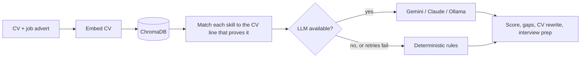

<div align="center">


# Software Engineer · Full-Stack · GenAI

**I build software that still works on a bad day.**
Production experience at a global SaaS company. Multi-agent AI with receipts.


[](https://www.linkedin.com/in/rahul-medi7/)
[](mailto:rahulmedi33@gmail.com)

</div>

---

```text
$ pytest rahul_medi/ -v

test_shipped_at_global_saas_company ................ PASSED
test_load_tested_apis_at_200_users ................. PASSED
test_contract_tests_catch_breaking_changes ......... PASSED
test_ai_pipeline_survives_llm_outage ............... PASSED
test_can_explain_every_line_of_my_resume ........... PASSED

5 passed, 0 failed, 1 pending: your_team.py
```

<div align="center">

| ⚡ **200** | 🧪 **2,517** | 🔌 **26** | 🏢 **2** |
|:---:|:---:|:---:|:---:|
| concurrent users in k6 load tests | pytest tests in CareerPilot AI | REST APIs in CareerPilot AI | internships completed |

</div>

---

## 👋 The short version

I'm a 2026 B.E. graduate (Information Science & Engineering). At **Diligent Corporation**, a global SaaS company, my work was less about new features and more about making sure existing ones didn't fall over: migrating a production SPA, fixing authentication failures, load testing APIs and writing contract tests.

Outside work, I build AI tools that have to show their evidence. Three things matter to me:

> **Evidence**: an AI answer should point to its source.
> **Resilience**: a system should degrade, not crash.
> **Proof**: if I say it works, there's a test or a load run behind it.

---

## 🚀 Projects

<div align="center">

| 🧭 [**CareerPilot AI**](https://github.com/RahulMedi07/CareerPilotAI) | ☁️ [**Attendance System**](https://github.com/RahulMedi07/Cloud-Based-Attendence-System) | 🎙️ [**Parkinson's Detection**](https://github.com/RahulMedi07/Early-Detection-Of-Parkinsons-Disease-Using-Voice-Data) |
|:---:|:---:|:---:|
| Multi-agent job match and interview prep | MERN college ERP with role-based access | Voice-based risk prediction |
|     |    |    |

</div>

### 🧭 CareerPilot AI
*Paste a CV and a job advert. Get a match score, the skill gaps, a tailored CV rewrite and interview prep.*


<sub>Simplified view. The real pipeline is an 8-node LangGraph graph served by FastAPI.</sub>

- 🔎 **Evidence first:** every matched skill is traced to a line in the CV through RAG over ChromaDB. If the CV doesn't prove it, the tool doesn't claim it.
- 🛟 **Always finishes:** retry-with-exponential-backoff, then deterministic fallbacks, so an LLM outage doesn't stop the analysis.
- 🔐 **26 REST APIs**, PBKDF2 password hashing, hashed session tokens and **2,517 pytest tests**.
- 🖥️ Next.js and TypeScript frontend, SQLite storage.

### ☁️ Cloud-Based Attendance System
A MERN college ERP with separate roles for admins, faculty and students. Faculty mark attendance, create tests and upload marks, and the system calculates attendance percentage by subject. JWT authentication, bcrypt hashing.

### 🎙️ Early Detection of Parkinson's Disease
A Streamlit app that takes a voice recording (live mic or WAV) and predicts risk from jitter, shimmer and HNR features extracted with Praat. It's a small dataset (195 samples), so I focused on a sound evaluation setup (stratified 5-fold cross-validation, class-imbalance handling) rather than chasing a headline accuracy number.

---

## 💼 What I actually did at Diligent

| The problem | What I did |
|---|---|
| An important reporting page was on an older SPA | Led the migration of "My Reports" to Reports Builder, from requirements analysis to AWS CI/CD deployment |
| The MCP gateway kept failing with 401/404 errors | Added JWT validation and retry-with-exponential-backoff logic |
| Nobody knew how the APIs behaved under load | Ran k6 load tests at up to 200 virtual users and read P50/P95/P99 latency in AWS CloudWatch |
| Python and Node.js services could drift apart | Built Pact consumer-driven contract tests so breaking changes fail before release |

*Software Development Intern · Diligent Corporation · Mar 2026 – Sep 2026*
*Full Stack Web Development Intern · SuprMentr Technologies · Dec 2025 – Feb 2026: a React, Node.js, Express and MongoDB finance app with JWT auth and an aggregation-pipeline dashboard.*

---

## 🧠 Ask me about

- Why retry logic needs **backoff**, and what happens without it
- Why **P95 and P99 latency** tell you more than the average
- What **contract testing** catches that integration tests miss
- How to make a **RAG system cite its evidence**
- What an AI app should do **when the model is down**

---

## 🛠️ Toolbox

<div align="center">


</div>

| | |
|---|---|
| **Languages** | Python, JavaScript, TypeScript, C++, SQL |
| **Web & APIs** | React, Next.js, Node.js, Express, FastAPI, REST APIs, JWT |
| **AI / GenAI** | LangGraph, LangChain, RAG, ChromaDB, embeddings, Gemini, Claude, Ollama, MCP, prompt engineering |
| **Data & ML** | MongoDB, SQLite, scikit-learn, Pandas, NumPy |
| **Quality** | Pact, k6, pytest, API testing |
| **Cloud** | AWS (CI/CD, CloudWatch), Git, GitHub, GitHub Actions |
| **Foundations** | DSA, OOP, operating systems, computer networks, DBMS, SDLC |

<details>
<summary>📜 Certifications</summary>

- Google Cloud Career Launchpad (Cloud Engineer Track), Google
- Cloud Computing, NPTEL
- Artificial Intelligence & Machine Learning, Coursera

</details>

---

<div align="center">

### 📫 If your team needs someone who tests before shipping, let's talk.

[](mailto:rahulmedi33@gmail.com)
[](https://www.linkedin.com/in/rahul-medi7/)

</div>
